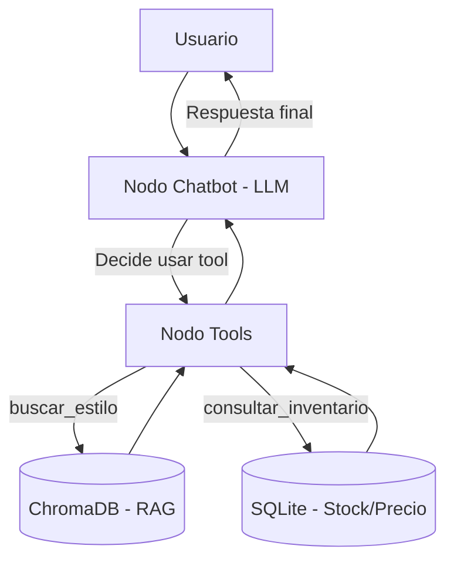

# Asistente Conversacional de Vestuario (Tema 2)

Trabajo Práctico Grupal - Módulo 6 (Diplomatura Universitaria en Inteligencia Artificial)  
**Integrantes:** Juan Ignacio Sampedro, Clara Murillo y Juan Cruz Muñóz.

## 1. Descripción del Problema y Alcance

El sistema es una prueba de concepto de un asistente conversacional que ayuda a un usuario a elegir vestuario para un evento. Combina preferencias y restricciones del usuario (evento, prendas propias, talle y presupuesto) con:

- **Búsqueda semántica (RAG):** Recuperación de guías de estilo desde texto no estructurado (`data/guias_estilo.txt`).
- **Validación estructurada (SQLite):** Verificación real de stock, talles y precios en `data/catalogo.db` para evitar alucinaciones de inventario.

## 2. Arquitectura y Frameworks Utilizados

- **LangGraph:** Orquestación del flujo cíclico del agente (patrón ReAct) y manejo del estado conversacional (`messages`).
- **LangChain + Ollama:** Integración del LLM local (`qwen2.5:latest`, por ejemplo) y definición de herramientas (`@tool`). Se optó por ejecución local con Ollama para no depender de APIs pagas ni credenciales externas.
- **ChromaDB + HuggingFace (`all-MiniLM-L6-v2`):** Base vectorial local y modelo de *embeddings* para el recuperador RAG.
- **SQLite:** Base de datos relacional que almacena el inventario de productos (código, tipo, color, talle, precio y stock).
- **Streamlit:** Interfaz web conversacional para pruebas interactivas.

### Diagrama de Flujo



## 3. Estructura del Repositorio

```text
/
├── data/                       # Generada por init_db.py (SQLite, guías y ChromaDB)
├── init_db.py                  # Crea la base SQLite y las guías de estilo
├── tools.py                    # Herramientas de RAG y consulta de inventario
├── agent.py                    # Grafo de LangGraph y configuración del LLM
├── app.py                      # Interfaz de chat en Streamlit
├── evaluacion.py               # Script de validación automática (5 casos)
├── resultados_evaluacion.json  # Evidencias generadas por la evaluación
├── requirements.txt            # Dependencias del proyecto
└── README.md                   # Documentación e informe breve
```

## 4. Requisitos e Instalación

- Python 3.10 o superior.
- [Ollama](https://ollama.com/) instalado y ejecutándose en segundo plano con el modelo descargado (`ollama run [tu_modelo]`).

Desde una copia limpia del repositorio:

```bash
# 1. Instalar dependencias
pip install -r requirements.txt
pip install langchain-ollama langchain-community

# 2. Inicializar la base de datos SQLite y las guías de estilo
python init_db.py
```

*(La primera ejecución descargará automáticamente el modelo de embeddings `all-MiniLM-L6-v2` de HuggingFace y construirá el índice local en `data/chroma_db`.)*

## 5. Cómo Usar la Aplicación

Para iniciar la interfaz de chat en Streamlit:

```bash
streamlit run app.py
```

Luego abrir el navegador en `http://localhost:8501`.

**Entradas sugeridas para probar:**

- **Caso exitoso:** *"Tengo un casamiento de noche y ya tengo un pantalón negro. Busco un saco en talle M, mi presupuesto es de 200."*
- **Caso problemático (sin stock):** *"Tengo un casamiento de noche, busco el saco azul marino en talle L, mi presupuesto es 200."*

## 6. Evaluación y Resultados

Para repetir la validación sobre el benchmark de 5 casos:

```bash
python evaluacion.py
```

Las entradas, respuestas esperadas, salidas observadas y resultados se guardan en `resultados_evaluacion.json`.

| Caso | Tipo | Validación Automática | Revisión Manual | Observación |
| :--- | :--- | :--- | :--- | :--- |
| 1 | Caso típico | Aprobado | Aprobado | Recomienda `S-001` talle M a $150 con stock verificado. |
| 2 | Dato faltante | Aprobado (Falso positivo) | Parcial | Listó la guía completa en lugar de pedir primero talle y presupuesto. |
| 3 | Evidencia insuficiente | Aprobado (Falso positivo) | Falló | Recomendó saco y camisa para esquiar por falta de umbral en el RAG. |
| 4 | Restricción de stock | Aprobado | Aprobado | Detectó `S-001` talle L agotado y propuso buscar alternativas. |
| 5 | Presupuesto excedido | Aprobado | Aprobado | Detectó que `V-001` (200)superaellímite(100) y consultó al usuario. |

### Hallazgos y Limitaciones

1. **RAG sin umbral de similitud (Caso 3):** Al recuperar siempre los `k=2` fragmentos más cercanos sin filtrar por distancia semántica, consultas fuera de dominio (como ropa para esquiar) reciben contexto irrelevante que el modelo intenta utilizar.
2. **Falsos positivos en la validación por palabras clave (Casos 2 y 3):** El chequeo automático marcó ambos casos como aprobados al detectar palabras aisladas (`talle`, `disponible`), lo que evidencia la necesidad de revisión manual o de un evaluador *LLM-as-a-judge*.
3. **Catálogo acotado:** Los datos actuales son sintéticos y reducidos, diseñados como prueba de concepto para validar la arquitectura del agente.
